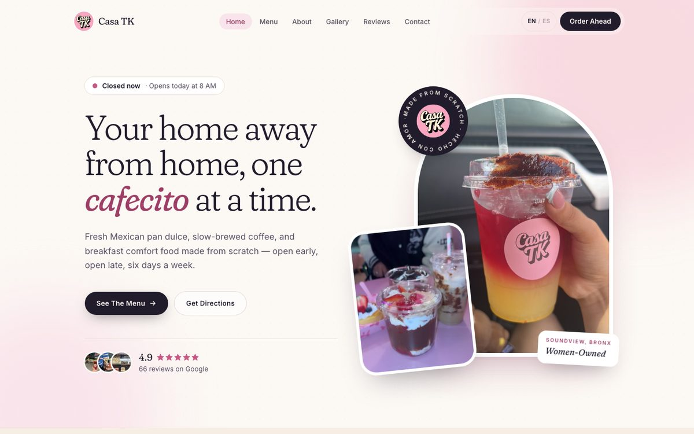
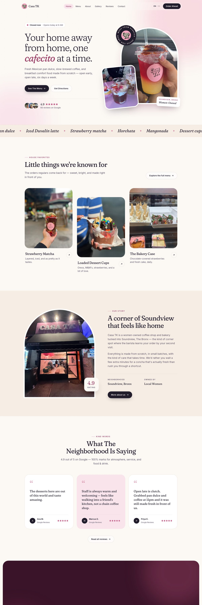
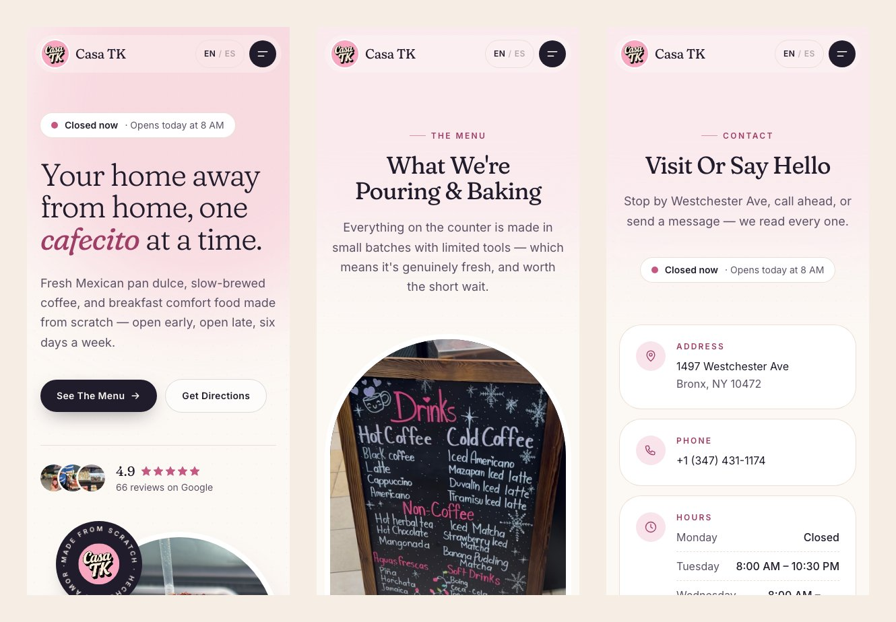
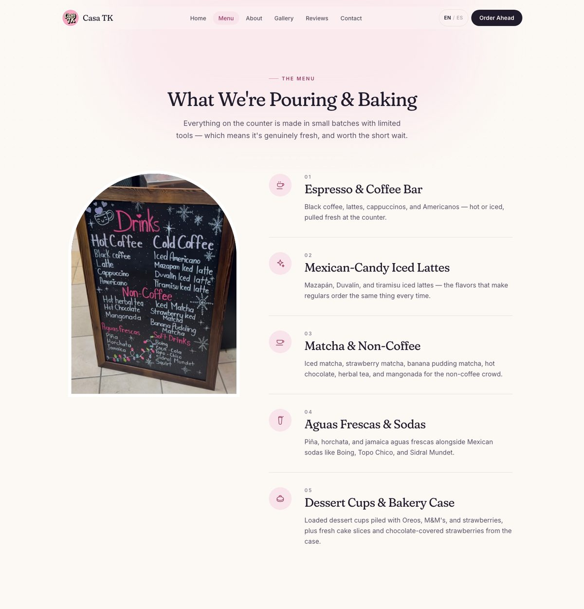
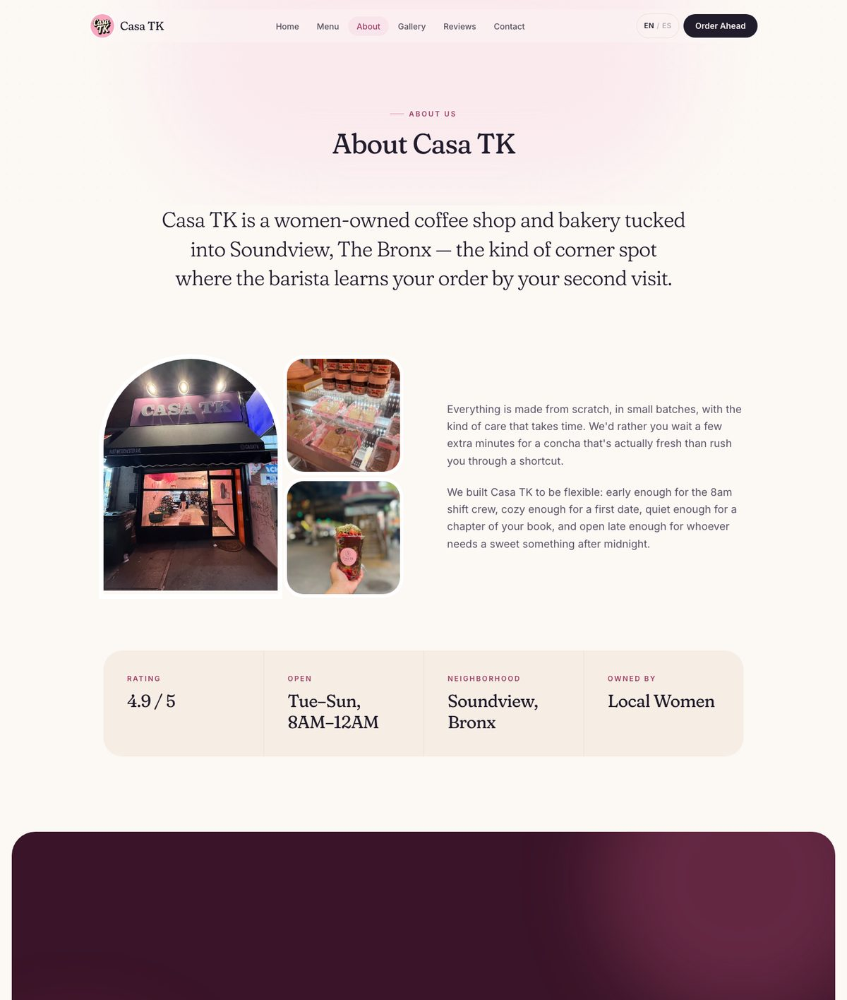
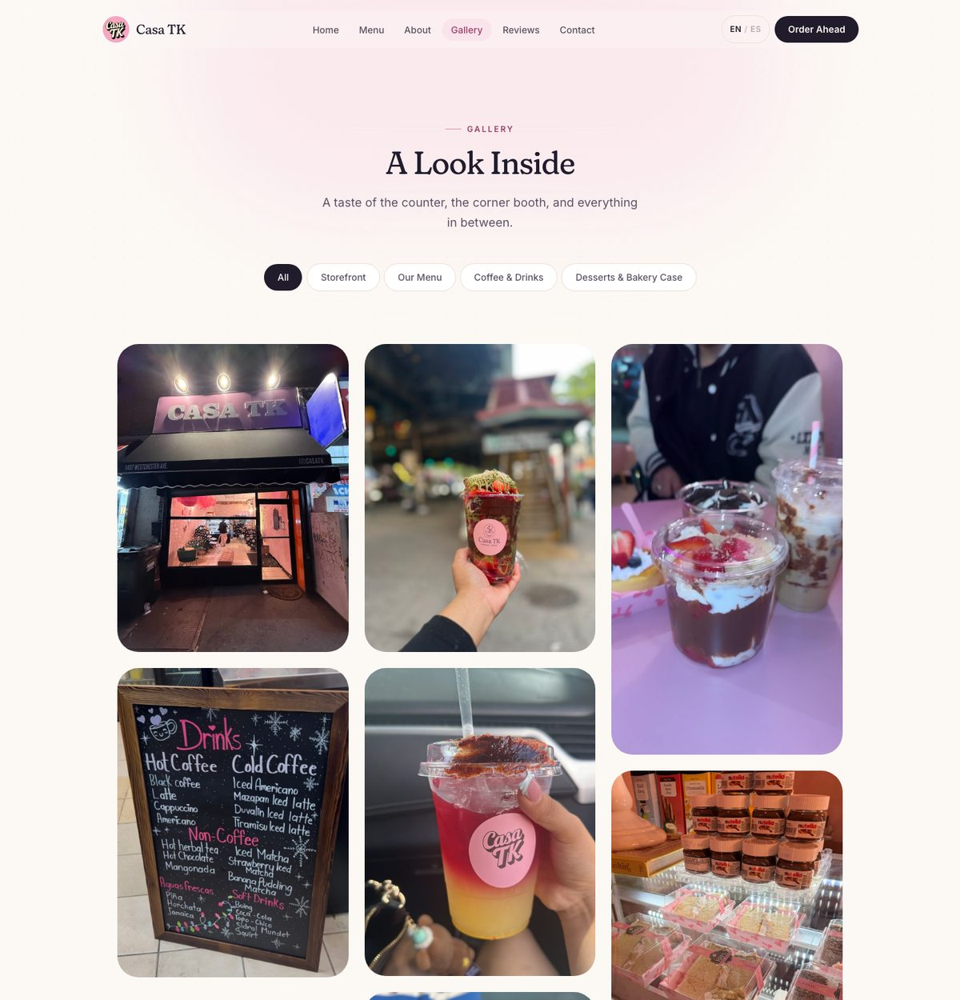
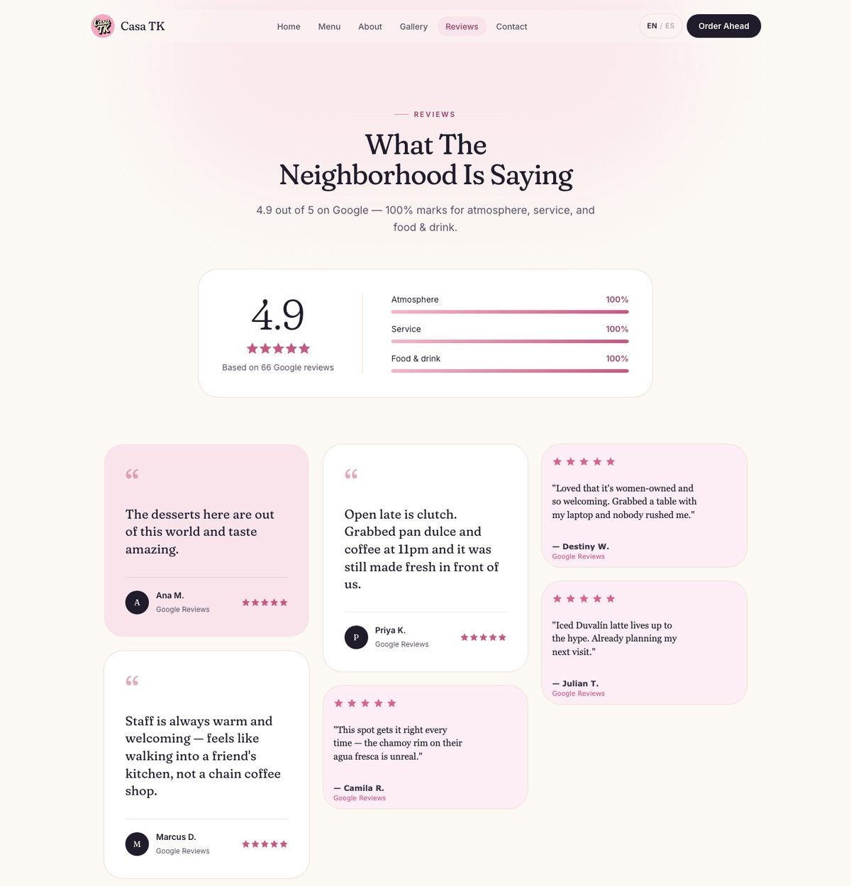
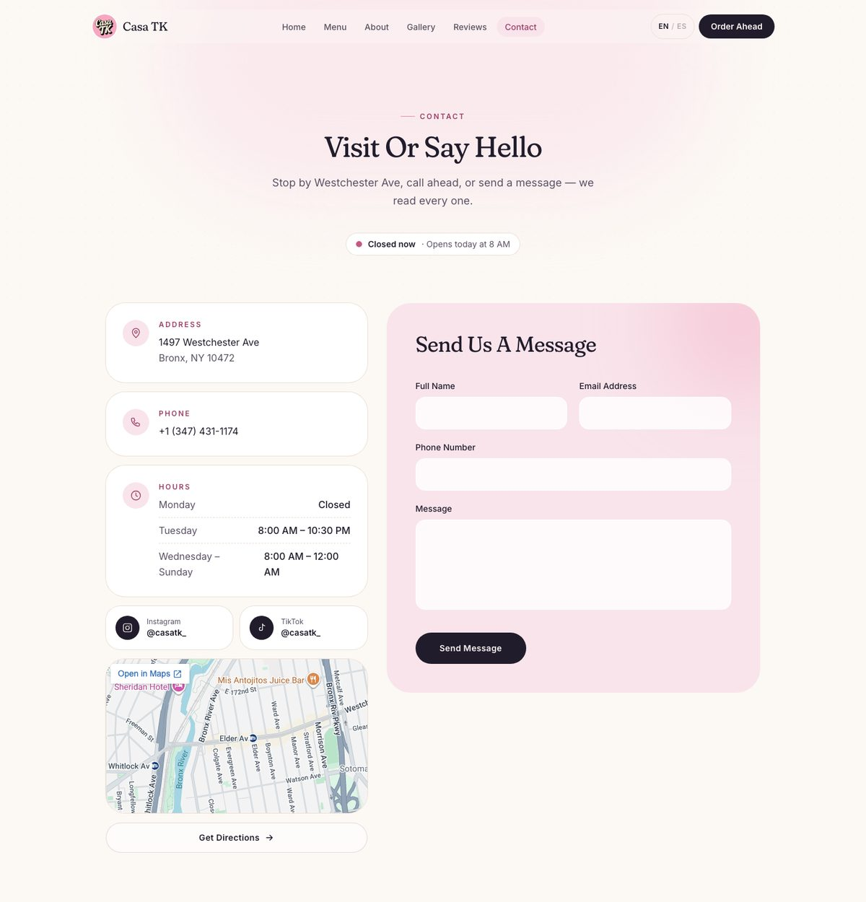

# Casa TK: Bronx Coffee & Bakery Website

**🌐 Live site:** [casa-tk.vercel.app](https://casa-tk.vercel.app/)  
**💻 Source code:** [github.com/WebDesign-MultiMedia/Casa_TK](https://github.com/WebDesign-MultiMedia/Casa_TK)



Casa TK is a real, women-owned coffee shop and bakery at **1497 Westchester Ave in Soundview, The Bronx**. It serves Mexican pan dulce, Mexican-candy iced lattes, matcha, aguas frescas and loaded dessert cups.

This repository holds the shop's marketing website: a **bilingual (English / Spanish), multi-page React app**. I designed and built it to give a small neighborhood business a modern online presence. The site uses the shop's **real** menu, photos, hours, address and Google rating, and keeps all of it in one place in the code.

---

## Contents

- [At a glance](#at-a-glance)
- [Screenshots](#screenshots)
- [Features](#features)
- [Design approach (UI/UX)](#design-approach-uiux)
- [Tech stack and tools](#tech-stack-and-tools)
- [Project structure](#project-structure)
- [Engineering highlights](#engineering-highlights)
- [SEO, accessibility and performance](#seo-accessibility-and-performance)
- [Running it locally](#running-it-locally)
- [Deployment](#deployment)
- [Notes and roadmap](#notes-and-roadmap)

---

## At a glance

| | |
|---|---|
| **Type** | Small-business marketing website (single-page app with client-side routing) |
| **Client** | Casa TK, an independent café and bakery in the Bronx, NY |
| **Role** | Full-stack developer and UI/UX designer: design, front-end development, content, SEO and deployment |
| **Pages** | Home · Menu · About · Gallery · Reviews · Contact |
| **Languages** | English and Spanish, switchable instantly from the navigation bar |
| **Stack** | React 19, Vite, Tailwind CSS v4, React Router 7, deployed on Vercel |
| **Responsive** | Designed for phones (from 390px wide), tablets and desktops |

---

## Screenshots

### Home: full page
The landing page tells the shop's story from top to bottom: a hero section with a live open/closed badge, a scrolling strip of menu items, house favorites, the shop's story, customer reviews and a "come visit" call to action.

<p align="center">
  
</p>

### Mobile
Every page is built mobile-first. The navigation collapses into a full-screen menu, and layouts stack into a single comfortable column.



### Menu
The shop's real chalkboard menu sits in an arch-shaped frame (inspired by the shop window) next to a numbered list of menu categories.



### About


### Gallery
Real photos from the shop's Google Business listing. Visitors can filter them by category and open any photo full screen.



### Reviews


### Contact


---

## Features

**For visitors**
- 🕐 **Live "Open now / Closed now" badge.** It always shows the shop's status in New York time, wherever the visitor is, for example *"Closed now · Opens Tuesday at 8 AM"*.
- 🌎 **English / Spanish toggle.** The whole site switches language at once, including page titles and SEO descriptions. This matters for the shop's largely bilingual neighborhood.
- 📋 **Menu page** built from the shop's actual chalkboard menu: espresso drinks, Mazapán and Duvalín iced lattes, matcha, aguas frescas, Mexican sodas and the dessert case.
- 🖼️ **Photo gallery** with category filters (Storefront, Menu, Drinks, Desserts), a staggered masonry layout and a full-screen viewer with next/previous buttons and keyboard arrow-key support.
- ⭐ **Reviews page** with a rating summary (4.9 / 5 from 66 Google reviews) and review cards.
- 📍 **Contact page** with address, click-to-call phone number, hours, Instagram and TikTok links, an embedded Google Map, a "Get Directions" link and a contact form with validation.
- 📱 **Fully responsive**, with a full-screen mobile menu that locks page scrolling and closes with the Escape key.

**Under the hood**
- Every page has its own URL (`/menu`, `/gallery`, …) through client-side routing, so links can be shared and bookmarked.
- Business facts (address, phone, hours, rating, social links) live in **one data file**. When something changes, the whole site updates.
- All visible text lives in **one translation file**, so copy can be edited without touching the layout code.

---

## Design approach (UI/UX)

The goal of the redesign was a site that feels **modern, spacious, elegant and lovable**, true to the shop's personality and easy to use.

**Brand-led palette.** The colors come straight from the shop itself: the pink of the logo, the cream of its script lettering, the blush-pink walls and the deep plum of the street sign. They're used as design tokens on a warm cream "paper" background, so the food photos stand out instead of competing with a busy background.

| Token | Hex | Used for |
|---|---|---|
| Paper | `#fcf8f4` | Page background |
| Blush | `#f9e4eb` | Soft highlight areas, cards |
| Rose | `#f3b6ca` | Accents (taken from the logo) |
| Pink dark | `#9e3e66` | Labels and emphasis (passes contrast on cream) |
| Plum dark | `#3a1428` | The "Visit us" band |
| Ink | `#211c2c` | Text and main buttons |

**Typography.** Headings use **Fraunces**, a soft serif with italics for warm details like *cafecito*: elegant without feeling stiff. Body text uses **Inter** for clean readability at small sizes.

**Visual motifs.**
- **Arch-shaped photo frames** echo the shop's front window.
- A **slowly rotating "Made from scratch · Hecho con amor" badge** around the logo, like a coffee-cup stamp.
- A gently **scrolling strip of menu items** under the hero.
- Generous whitespace, large rounded corners and a faint paper texture on cream areas.

**Motion with restraint.** Sections fade up gently the first time they scroll into view, and pages fade in on navigation. All animation turns off automatically for visitors who have set "reduce motion" on their device.

**UX decisions.**
- The **live open/closed status** answers the first question most café visitors have: "Are they open right now?"
- The main actions (**See the Menu**, **Get Directions**, **Call us**) appear on every page, close to where a visitor would need them.
- The navigation highlights the current page, and the floating nav bar gains a shadow when you scroll so it always stays readable.

---

## Tech stack and tools

| Tool | What it's used for |
|---|---|
| **[React 19](https://react.dev/)** | Component-based UI |
| **[Vite 8](https://vite.dev/)** | Fast development server and optimized production builds |
| **[Tailwind CSS v4](https://tailwindcss.com/)** | Utility-first styling, with brand colors and fonts defined as theme tokens in CSS (`@theme`) |
| **[React Router 7](https://reactrouter.com/)** | Client-side routing between pages |
| **React Context** | Global language state (English / Spanish) shared with every component |
| **[Google Fonts](https://fonts.google.com/)** | Fraunces (headings) and Inter (body), loaded without blocking the first paint |
| **`Intl.DateTimeFormat` (built into browsers)** | Works out the current day and time in New York for the open/closed badge |
| **`IntersectionObserver` (built into browsers)** | Triggers the scroll-reveal animations without any animation library |
| **Google Maps embed** | Interactive location map on the Contact page |
| **Schema.org JSON-LD** | Structured business data so Google can show hours, rating and address in search results |
| **[Vercel](https://vercel.com/)** | Hosting and continuous deployment from GitHub |
| **Git and GitHub** | Version control |
| **Headless Google Chrome** | Visual QA screenshots at desktop and mobile widths (including the images in this README) |
| **Claude Code** | AI pair-programming assistant used during the redesign |

There are **no UI component libraries, icon libraries or animation libraries**. Icons are hand-written inline SVGs, and the animations use plain CSS. That keeps the bundle small and the design fully custom.

---

## Project structure

```
Casa_TK/
├── index.html                 # HTML shell: SEO meta tags, Open Graph tags, font loading
├── vercel.json                # Rewrite rule so deep links like /menu work on refresh
├── public/
│   ├── gallery/               # Real photos from the shop's Google listing
│   ├── reviews/               # Review cards rendered as SVG images
│   ├── logo.jpeg
│   ├── robots.txt
│   └── sitemap.xml
├── docs/screenshots/          # Images used in this README
└── src/
    ├── main.jsx               # App entry point
    ├── App.jsx                # Router and page routes
    ├── index.css              # Design tokens (colors, fonts), animations, global styles
    ├── components/
    │   ├── ui.jsx             # Shared design-system pieces: Button, SectionHeading,
    │   │                      #   PageHeader, Reveal (scroll animation), Stars, OpenStatus, icons
    │   ├── Navbar.jsx         # Floating nav bar, mobile menu, language toggle
    │   ├── Hero.jsx           # Homepage hero, photo collage and rotating badge
    │   ├── Services.jsx       # Menu page content
    │   ├── About.jsx          # About page content
    │   ├── Gallery.jsx        # Filterable masonry gallery
    │   ├── Lightbox.jsx       # Full-screen image viewer
    │   ├── Reviews.jsx        # Rating summary and review cards
    │   ├── Contact.jsx        # Contact info, map and validated form
    │   ├── VisitBand.jsx      # "Come say hola" call-to-action band used on several pages
    │   ├── Footer.jsx
    │   ├── Layout.jsx         # Shared page frame (nav, page transition, footer)
    │   ├── ScrollToTop.jsx    # Scrolls back to the top when the page changes
    │   └── StructuredData.jsx # Injects the Schema.org business data
    ├── pages/                 # One small file per route; each sets its own page title and description
    ├── data/
    │   ├── business.js        # Single source of truth: address, phone, hours, rating, socials
    │   ├── translations.js    # All site copy in English and Spanish
    │   ├── gallery.js         # Gallery photos, categories and bilingual alt text
    │   └── imageReviews.js
    ├── context/
    │   └── LanguageContext.jsx
    ├── hooks/
    │   └── usePageMeta.js     # Updates the title, description, canonical URL and social tags per page
    └── lib/
        └── openStatus.js      # Open/closed logic based on New York time
```

---

## Engineering highlights

**1. Content kept apart from code.**
Text, business details and gallery data each live in a dedicated file under `src/data/`. Components only handle layout. When the shop changes its hours, or someone needs to fix a Spanish phrase, there's exactly one place to edit.

**2. Time-zone-aware open/closed status** (`src/lib/openStatus.js`).
Hours are stored per weekday. The current day and time come from `Intl.DateTimeFormat` with `timeZone: "America/New_York"`, so the badge is correct even for someone checking from California. When the shop is closed, the code looks ahead to find the next opening ("today", "tomorrow" or a weekday name, in the visitor's language). The badge refreshes every minute.

**3. A small in-house design system** (`src/components/ui.jsx`).
Buttons, section headings, page headers, star ratings, icons and the scroll-reveal wrapper are reusable components with variants. That keeps all six pages visually consistent and makes new sections quick to build.

**4. Dependency-free animation.**
The `Reveal` component uses `IntersectionObserver` to add a CSS class once, the first time an element enters the screen, and then stops watching it. The scrolling menu strip and rotating badge are pure CSS keyframes. Everything respects `prefers-reduced-motion`.

**5. Practical single-page-app fixes.**
- `vercel.json` sends every route to `index.html`, so refreshing `/gallery` doesn't return a 404.
- The mobile menu is rendered *next to* the header instead of inside it. A CSS `backdrop-filter` on the header would otherwise trap the full-screen overlay inside the header's small box.
- Page scrolling is locked while the mobile menu or image viewer is open.

---

## SEO, accessibility and performance

**SEO**
- A unique `<title>` and meta description for every page, in both languages (`usePageMeta` hook).
- Canonical URLs, Open Graph and Twitter Card tags for good link previews on social media and messaging apps.
- `CafeOrCoffeeShop` structured data (JSON-LD) with address, map coordinates, hours, price range and rating.
- `sitemap.xml` and `robots.txt`.

**Accessibility**
- Semantic HTML: `nav`, `main`, `header`, `footer`, `figure`, `blockquote` and description lists.
- Descriptive alt text on every photo, in both languages.
- Visible keyboard focus outlines on everything you can click.
- Image viewer and mobile menu work fully from the keyboard (Escape to close, arrow keys to browse).
- Form fields have proper labels; errors are announced with `aria-invalid` and `aria-describedby`.
- Gallery filter buttons expose their on/off state with `aria-pressed`.
- Animations are disabled for users who prefer reduced motion.
- Text colors were chosen for readable contrast on the cream background.

**Performance**
- Production bundle: about **93 KB of JavaScript** and **9 KB of CSS** after gzip.
- Fonts load without blocking the first paint (`media="print"` swap technique, plus `display=swap`).
- Images below the fold load lazily; the main hero image is marked high priority.
- No heavy third-party UI or animation libraries.

---

## Running it locally

You need **[Node.js](https://nodejs.org/) 20.19 or newer** (22 LTS recommended).

```bash
# 1. Clone the repository
git clone https://github.com/WebDesign-MultiMedia/Casa_TK.git
cd Casa_TK

# 2. Install dependencies
npm install

# 3. Start the development server (opens on http://localhost:5173)
npm run dev
```

Other commands:

```bash
npm run build    # Create an optimized production build in /dist
npm run preview  # Serve the production build locally to test it
```

---

## Deployment

The site is hosted on **Vercel** and connected to this GitHub repository. Every push to `main` triggers a new production build and deploy automatically. The `vercel.json` rewrite rule makes direct links and page refreshes work on every route.

---

## Notes and roadmap

**Good to know**
- **Contact form:** validation and the loading and success states are fully built, but sending is currently **simulated**, because no email backend is connected yet.
- **Reviews:** some review quotes are representative examples written for the site, not copied word for word from Google. The overall rating (4.9 from 66 reviews) is real and comes from the shop's Google listing.
- **Photos:** all photos come from Casa TK's own Google Business listing.

**Possible next steps**
- Connect the contact form to a real email service (for example Resend or Formspree) or a serverless function.
- Link the "Order Ahead" button to an online ordering platform.
- Pull live reviews from the Google Places API.
- Remember the visitor's language choice, and add `/es/…` URLs for Spanish SEO.
- Pre-render pages at build time so social-media link previews can be specific to each page.

---

<p align="center">
  Made in and for the Bronx 🩷 ·
  <a href="https://casa-tk.vercel.app/">casa-tk.vercel.app</a>
</p>
